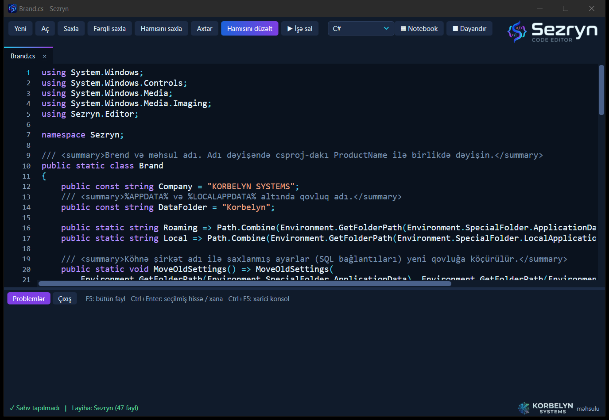
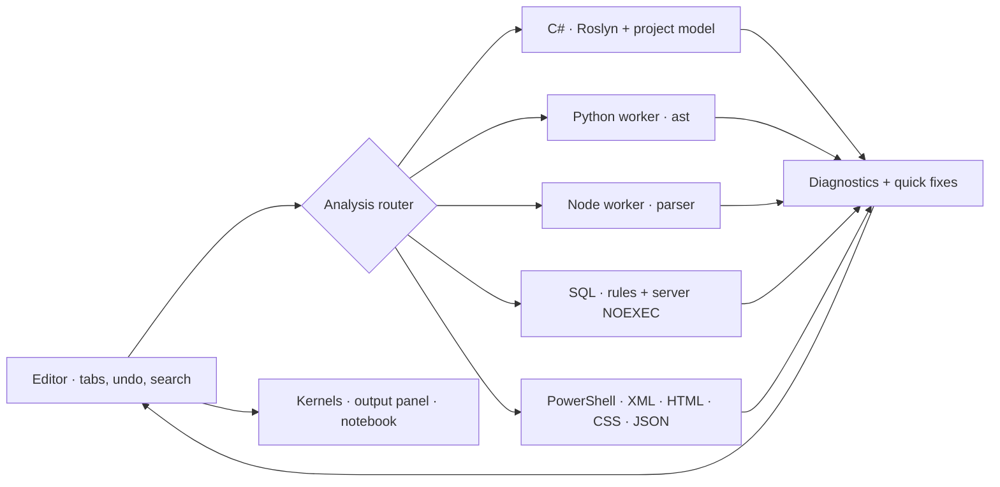
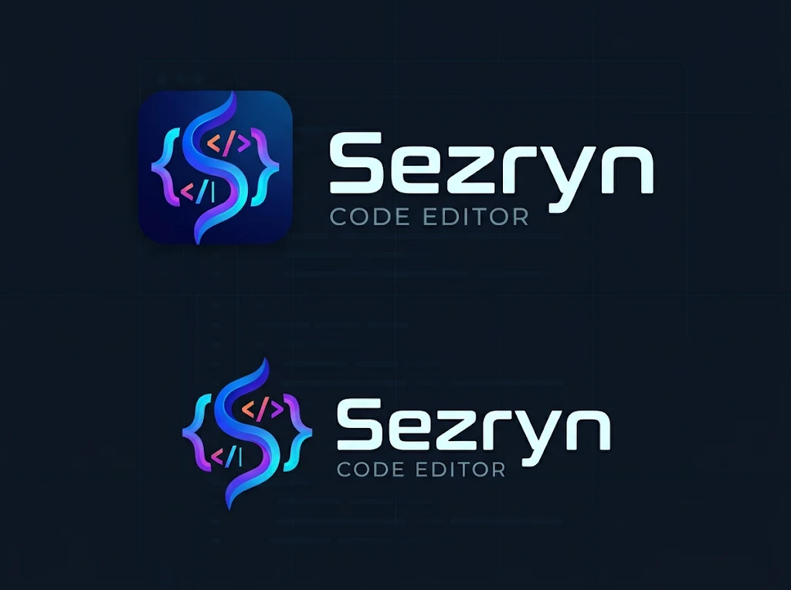

# Sezryn — Code Editor

**A product of [KORBELYN SYSTEMS](https://github.com/Korbelyn-Systems)**

    

A lightweight Windows code editor that catches mistakes **while you type** and offers the correct fix —
simpler than a full IDE, aimed at people who write scripts, queries and small programs every day.

## What it does
- **Live analysis with one-key fixes** — wrong symbols (smart quotes, `×`, hidden spaces, Cyrillic look-alike letters), missing brackets and semicolons, misspelled keywords and member names. `Alt+Enter` applies one fix, `F8` applies every safe fix at once (one `Ctrl+Z` undoes all).
- **Many languages in one window** — C#, Python, JavaScript, JSON, SQL, PowerShell, XML/XAML, HTML and CSS.
- **Whole-project C# understanding** — finds the `.csproj`, NuGet packages, WPF `x:Name`, project references — without running MSBuild or any build step.
- **Autocomplete** — fuzzy matching (`WL` → `WriteLine`), adds missing `using` automatically.
- **Run inside the editor** — `F5` / `Ctrl+Enter`, output in the built-in panel; notebook mode with `# %%` cells (Jupyter-style, plain-text files).
- **SQL Server workbench** — connect, live schema-aware checks compiled with `SET NOEXEC ON` (never executed), results grid, confirmation for `DELETE`/`UPDATE` without `WHERE`, `DROP`, `TRUNCATE`.

## Safety by design
- Analysis is local; nothing is sent to the internet and your code is never executed until you press `F5`.
- Opening a project never runs MSBuild targets; only signed Microsoft / .NET Foundation source generators load.
- Saved database passwords are encrypted with Windows DPAPI.

## How it is built

Covered by its own regression suite: UI scenarios, keyboard tests, real-project mutation tests ("a quick fix must never make code worse") and live SQL Server tests.

## Brand

---

> **Showcase repository.** This repo describes what the product does and how it is designed.
> The source code is proprietary to KORBELYN SYSTEMS and is not published. For a demo, get in touch.

**KORBELYN SYSTEMS** · Tural Zamanlı · [Portfolio](https://dicapso.github.io) · [GitHub](https://github.com/Dicapso)
